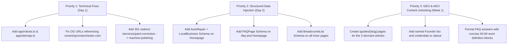

# 🔍 Latin King Detailing — Comprehensive SEO / GEO / AEO Audit Report

**Target Domain:** [latinkingdetailing.co.uk](https://latinkingdetailing.co.uk)  
**Audit Scope:** Full Audit across SEO, GEO, and AEO  
**Audit Date:** 20 November 2026  
**Generated Files:**
- **Word Document (.docx):** [seo-audit-latinkingdetailing-co-uk-2026-11-20.docx](file:///Users/aditya/Development/gig/clients/uk/latinkingdetailing/reports/seo-audit-latinkingdetailing-co-uk-2026-11-20.docx)
- **PDF Document (.pdf):** [seo-audit-latinkingdetailing-co-uk-2026-11-20.pdf](file:///Users/aditya/Development/gig/clients/uk/latinkingdetailing/reports/seo-audit-latinkingdetailing-co-uk-2026-11-20.pdf)

---

## 1. Executive Summary

Latin King Detailing possesses outstanding real-world fundamentals: an authentic **5.0★ Google rating across 60+ verified customer reviews**, accredited **Ceramic Pro 9H Certified Installer** status, and an established physical base at **426 Flixton Road, Urmston, Manchester**.

However, **critical technical blockers currently prevent search engines and generative AI agents from discovering and recommending the business**:
1. **Critical 404 Crawl Errors:** Both `https://latinkingdetailing.co.uk/robots.txt` and `https://latinkingdetailing.co.uk/sitemap.xml` return HTTP 404 in production.
2. **Conflicting Domain in OpenGraph Tags:** The `/faq` and `/comparison` pages hardcode their OpenGraph URLs to `https://ceramicpromanchester.com/...` instead of `latinkingdetailing.co.uk`.
3. **Structured Data Deficits:** The homepage lacks `AutoRepair` / `LocalBusiness` JSON-LD schema, depriving Google of NAP, geo-coordinates, operating hours, and entity linkage. The FAQ page has zero `FAQPage` schema.
4. **Dormant High-Value Content:** Comprehensive informational guides (e.g. *Ceramic vs Wax*, *UK Winter Maintenance*, *Paint Correction Science*) are defined in the codebase but have no indexable standalone URLs.

---

## 2. Dimension Scorecard

| Dimension | Score | Status | Key Takeaways |
|---|---|---|---|
| **SEO (Search Engines)** | **5.2 / 10** | Needs Attention | Missing `robots.txt` and `sitemap.xml` (404s); title tags (>60 chars) and meta descriptions (>160 chars) truncated; foreign OG domains. |
| **GEO (Generative AI)** | **4.4 / 10** | Below Average | Founder unnamed on About page (E-E-A-T gap); guides trapped in TypeScript arrays; missing `sameAs` entity links for social profiles. |
| **AEO (Answer Engines & Voice)** | **4.8 / 10** | Below Average | Zero `FAQPage` schema; answers lack 40–60 word direct definition blocks; comparison table lacks snippet caption & headers. |
| **Combined Overall Score** | **14.4 / 30 (48%)** | **High Growth Potential** | Strong brand credibility throttled by easily fixable technical and semantic gaps. |

---

## 3. Crawl & Route Inventory

| Route | Page Type | Status | Findings |
|---|---|---|---|
| `https://latinkingdetailing.co.uk/` | Homepage | `200 OK` | Strong visual hero, trust badges; **missing LocalBusiness / AutoRepair schema**. |
| `https://latinkingdetailing.co.uk/about` | Founder & Mission | `200 OK` | First-person story ("I founded..."); **founder is unnamed** (E-E-A-T penalty). |
| `https://latinkingdetailing.co.uk/services` | Service Index | `200 OK` | Meta description 227 characters (truncated in search results). |
| `https://latinkingdetailing.co.uk/services/ceramic-coating` | Flagship Service | `200 OK` | High quality `Service` schema; great technical depth; missing Breadcrumb schema. |
| `https://latinkingdetailing.co.uk/services/machine-polishing` | Paint Correction | `200 OK` | Paint correction mapped to `/machine-polishing`; `/paint-correction` is 404. |
| `https://latinkingdetailing.co.uk/services/[other 5 slugs]` | Service Details | `200 OK` | All 7 services active with dynamic metadata. |
| `https://latinkingdetailing.co.uk/locations` | Coverage Hub | `200 OK` | Covers 10 Manchester & Cheshire towns; strong NAP; needs geo-specific landing hubs. |
| `https://latinkingdetailing.co.uk/reviews` | Reviews & Social Proof | `200 OK` | 60+ verified reviews surfaced; lacks `Review` / `AggregateRating` schema. |
| `https://latinkingdetailing.co.uk/faq` | FAQs | `200 OK` | **Defect:** OG URL points to `ceramicpromanchester.com/faq`; NO `FAQPage` schema. |
| `https://latinkingdetailing.co.uk/comparison` | Protection Matrix | `200 OK` | **Defect:** OG URL points to `ceramicpromanchester.com/comparison`. |
| `https://latinkingdetailing.co.uk/our-work` | Visual Portfolio | `200 OK` | Title tag is 88 characters (truncated). Image alt attributes are well structured. |
| `https://latinkingdetailing.co.uk/robots.txt` | Bot Directives | **`404 NOT FOUND`** | Critical: Search engines and AI crawlers have no directive guidance. |
| `https://latinkingdetailing.co.uk/sitemap.xml` | XML Sitemap | **`404 NOT FOUND`** | Critical: Crawlers cannot discover dynamic service and content URLs. |

---

## 4. Priority Recommendations Matrix

| Priority | Issue / Action Item | Dimension | Effort | Business Impact |
|---|---|---|---|---|
| 🔴 **CRITICAL** | **Deploy `app/robots.ts` and `app/sitemap.ts`** to fix 404 crawl errors and allow Google, GPTBot, and Perplexity to index all routes. | SEO / GEO | 15 mins | Immediate indexing recovery |
| 🔴 **CRITICAL** | **Fix OpenGraph URL domain mismatches** on `/faq` and `/comparison` pointing to `ceramicpromanchester.com`. | Technical SEO | 5 mins | Eliminates canonical confusion |
| 🟠 **HIGH** | **Inject `AutoRepair` & `LocalBusiness` JSON-LD schema** on homepage with geo coordinates (`53.4447`, `-2.3843`), telephone, opening hours, and `sameAs` social links. | SEO / GEO | 30 mins | Google Maps / Local 3-Pack boost |
| 🟠 **HIGH** | **Add `FAQPage` JSON-LD schema** to `/faq` and homepage FAQ accordion component. | AEO | 20 mins | Google Rich Snippet accordions |
| 🟠 **HIGH** | **Publish standalone `/guides` or `/blog` routes** for the 3 expert articles currently locked inside `site-data.ts`. | GEO / AEO | 45 mins | Direct citations in AI search engines |
| 🟡 **MEDIUM** | **Optimize Title tags (50–60 chars) & Meta descriptions (150–160 chars)** to prevent SERP truncation ellipses. | On-Page SEO | 30 mins | Increased organic search CTR |
| 🟡 **MEDIUM** | **Alias `/services/paint-correction`** to `/services/machine-polishing` via Next.js redirect or dedicated rewrite. | Technical SEO | 10 mins | Eliminates 404 for high-value search query |
| 🟢 **QUICK WIN** | **Name the Founder on `/about`** with title, background, and headshot quote to maximize Google E-E-A-T and AI entity extraction. | GEO / E-E-A-T | 15 mins | Establishes authoritative Person entity |

---

## 5. What is Working Well

- **Impeccable Reputation:** 60+ verified 5.0-star Google reviews with direct deep links to Google Maps.
- **Recognized Certification:** Ceramic Pro 9H accredited installer with VIN-registered manufacturer warranties.
- **Local Geographic Density:** Natural, scannable mentions of Urmston, Flixton, Stretford, Sale, Altrincham, Hale, Bowdon, Partington, and Greater Manchester.
- **Fast, Modern Architecture:** Built with Next.js 16 and Tailwind CSS 4, supporting dark/light mode and mobile-first responsiveness.
